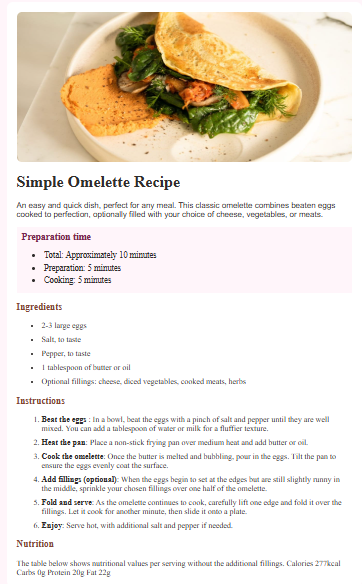

# Frontend Mentor - Recipe page solution

This is a solution to the [Recipe page challenge on Frontend Mentor](https://www.frontendmentor.io/challenges/recipe-page-KiTsR8QQKm). Frontend Mentor challenges help you improve your coding skills by building realistic projects. 

## Table of contents

- [Screenshot](#screenshot)
- [What I learned](#what-i-learned)
- [Continued development](#continued-development)
- [Author](#author)

### Screenshot



### What I learned

I have learned details patience and productiveness over pressure.

To see how you can add code snippets, see below:

```html
<h1>Some HTML code I'm proud of is definitely the divs as i have ordered and arranged them well</h1>
```
```css
.proud-of-this-css {
  color: papayawhip;
}
```
```js
const proudOfThisFunc = () => {
  console.log('🎉')
}
```

### Continued development

Consistency and ability to identify details and make them simpler to solve problems critically and not complicate or make them hard to understand.

## Author

- Website - [Samuel Kingsley Inyang](https://www.your-site.com)
- Frontend Mentor - [@samuelkinyang-tech](https://www.frontendmentor.io/profile/yourusername)